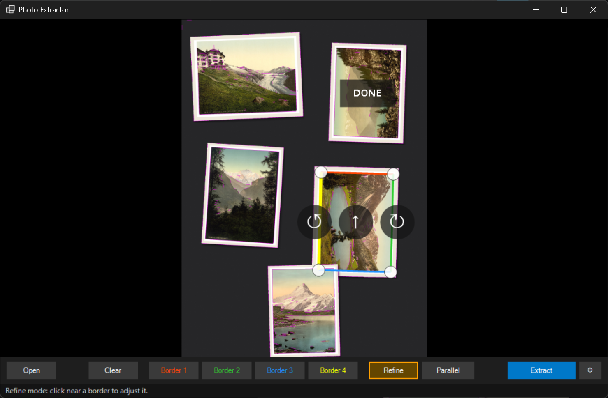
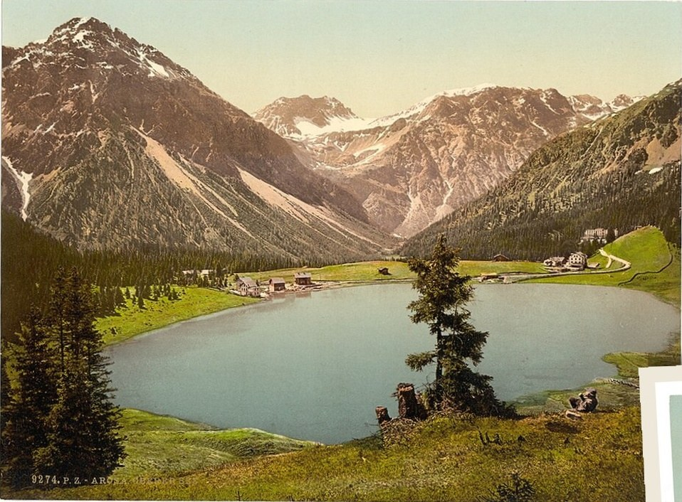

# PhotoExtractor

A Windows app for digitising old photo albums. Scan or photograph an album page, then save each photo on it as its own picture: straight, properly cropped and the right way up.

*A demo album page made of public-domain photochrom prints (Library of Congress).*

## Why PhotoExtractor?

Album photos are rarely straight: they are glued at an angle, overlap each other, or were shot from the side. Automatic tools often miss them or distort them, and cutting them out by hand in a photo editor takes ages when you have hundreds.

PhotoExtractor sits in between: it finds the edges for you, you pick the four that frame each photo, and it straightens the photo. You get one clean picture per photo.

## Install

1. Open the download page: [click here](https://github.com/amandiofr/PhotoExtractor/releases/latest).
2. Under **Assets** (click the word to expand it), click the file `PhotoExtractor-Setup-….exe`.
3. Open the downloaded file and follow the wizard (Next → Next → Install).

PhotoExtractor then starts, and you will find it in the Start menu. Nothing else to install, and no administrator rights needed.

> The first time, Windows may say "Windows protected your PC", because the app isn't signed. Click **More info**, then **Run anyway**.

To uninstall it: **Add or remove programs** in Windows Settings.

## Use

1. **Open a page**: click **Open**, or drag one or more pictures onto the window. Each one opens in its own tab.
2. **Show the edges**: tick **Lines** and move the sliders until the edges of your photo show up as lines. If the result isn't good, try the other detector (**Hough** or **LOCR**).
3. **Frame the photo**: click **Border 1**, then click the line along one edge of the photo. Do the same for borders 2, 3 and 4.
4. **Adjust if needed**: click **Refine**. You can then drag a border, click a better line, or drag one of the four corner handles. A magnifier appears while dragging a corner, for precise placement. **Parallel** lines a border up with the opposite one.
5. **Set which way is up**: if the photo is sideways or upside down, click **↺** or **↻** until the arrow (and the **UP** label) points to the top of the photo.
6. **Click Extract**: the photo is saved next to the page picture, and its area is marked **DONE** on the page so you know it's done.

Then frame the next photo on the page.

## Good to know

- Extracted photos are saved in the same folder as the page, named `page_01_Extractored.jpg`, `page_02_Extractored.jpg`, and so on (high-quality JPEG).
- Zoom with the mouse wheel; move around by dragging with the right or middle mouse button. **Ctrl+0** resets the view, **Ctrl+O** opens a picture.
- The app remembers your open pages, settings and window layout for next time.
- It works with flatbed scans as well as photos taken with a camera or a phone.

## License

GNU GPL v3: you are free to use, change and share this app, as long as what you share stays free and open,
under the same license. Full text: [click here](LICENSE).

## For developers

Building, the installer and how it works: [click here](docs/TECHNICAL.md).
